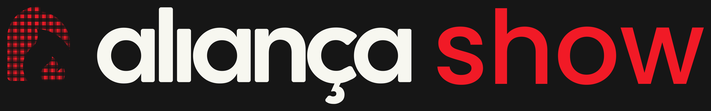

<p align="center">
  
</p>

<p align="center">
  Software de envio de vídeos e imagens para projetores e painéis de LED.
</p>

## Sobre

O AliançaShow é o programa de projeção usado nos cultos: monta o roteiro antes
e, na hora, controla o que aparece nas telas — letras de música, textos
bíblicos, vídeos, imagens e avisos — com saída para projetores e painéis de LED.

É um aplicativo de computador (Electron + Svelte) feito a partir do
[FreeShow](https://github.com/ChurchApps/FreeShow), e herda tudo que ele faz:
apresentação de letras e slides, stage display para os músicos, controle remoto
pelo celular, importação de Bíblias, saída NDI, gravação e múltiplas saídas
simultâneas.

## O que muda em relação ao FreeShow

Este não é um rebrand de superfície. As diferenças que importam no uso:

**Já vem com o conteúdo da igreja**

- As **Bíblias NVI e ARA** vão embutidas no instalador e são instaladas na
  primeira execução — ninguém precisa baixar Bíblia em máquina nova. Os
  arquivos não ficam no repositório (texto licenciado): veja
  [Gerando o instalador](#gerando-o-instalador).
- **306 músicas** importadas do ProPresenter vão junto, na categoria Músicas.
- Um layout de palco **Retorno** (slide atual, próximo e relógio) já vem
  criado: é só escolher em Configurações → Saídas, na saída da TV de retorno.

**Integração com o [AliançaShow Remote](https://github.com/AliancaShow/AliancaShow-Remote)**

A equipe envia fotos, vídeos e músicas pelo celular durante a semana; o app
recebe esse material sem ninguém copiar arquivo na mão. A árvore do Storage é
espelhada na pasta Online do disco, e remover um item no Remote remove também
aqui. A pasta de shows é observada: mudou na pasta, recarrega sozinho.

O painel **Cultos** tem as abas Todos, Aliança, Impulso e Extra. Cada agenda é
uma pasta raiz (`Alianca/2026/09-setembro/06`), com o mesmo desenho do
Storage; o evento Extra criado no celular aparece com o nome.

Do celular também dá para:

- **Passar slide** (avançar, voltar, limpar e saltar para um item), vendo o
  que está no ar. Responde o computador que tem o culto aberto; se dois
  estiverem no mesmo culto, só o primeiro (o "dono") obedece.
- **Mandar versículo**: vira um show aqui, um slide por versículo, na
  tradução escolhida.
- **Ver o que foi montado no computador** e tirar do culto por lá.

O código fica em `src/frontend/utils/alianca*.ts` e `agendas.ts`. Para testar
sem tocar no banco da igreja, rode com o emulador do Firebase:
`VITE_ALIANCA_EMULADOR=127.0.0.1 npm start` (só vale em desenvolvimento; no
build de produção isso não existe).

**Layout D**

As oito abas da biblioteca ficam na metade de baixo do painel esquerdo, não na
barra do rodapé. Clicar numa aba abre o conteúdo dela no painel inferior do
centro, logo abaixo da grade de slides.

**Fonte embutida**

A Montserrat vai dentro do app, declarada em `public/global.css`. As músicas
convertidas pedem `font-family:'Montserrat'` peso 900; embutida, elas aparecem
certas em qualquer computador que receba o instalador, sem depender de
instalação no Windows — que exigiria permissão de administrador.

**O que foi retirado**

- Telemetria: Google Analytics e Sentry.
- O canal de atualização automática, que apontava para o projeto do autor
  original.
- Pixabay e Unsplash da aba Online.

**Identidade própria**

Nome, ícones e logotipo, com os arquivos de marca em
[`brand-aliancashow/`](brand-aliancashow). A assinatura de código do Windows
está desativada: o build original usava a conta Azure do projeto de origem, à
qual não temos acesso. O instalador sai sem assinatura e o SmartScreen avisa na
primeira execução.

## Rodando em desenvolvimento

Requisitos: [Node.js](https://nodejs.org/) 22.12+,
[Python 3.12](https://www.python.org/downloads/) com `setuptools`, e — no
Windows — o Visual Studio com "Desenvolvimento para desktop com C++" e o
Windows 10 SDK. No Linux, `libfontconfig1-dev`. Python e o compilador são
necessários porque dependências como NDI, áudio e SQLite são módulos nativos.

```bash
npm install
npm start
```

**Baixe o projeto numa pasta sem espaços no caminho**, como `C:\AliancaShow` ou
`~/AliancaShow`. O módulo do NDI (`grandiose`) passa o caminho ao linker sem
aspas, e em `.../Maria Silva/...` ou `.../AliançaShow All/...` o `npm install`
falha com `no such file or directory: 'All/...'`.

Problemas conhecidos ao instalar:

- **No macOS, `tapi error: malformed file` / `unknown architecture`**: sobrou
  um SDK mais novo que o linker (comum depois de um beta). Reinstale as
  Command Line Tools: `sudo rm -rf /Library/Developer/CommandLineTools && xcode-select --install`.
- **`npm start` cai com `Cannot read properties of undefined (reading 'on')`**:
  o terminal está com `ELECTRON_RUN_AS_NODE=1`, que o terminal integrado do
  VS Code herda. Rode `unset ELECTRON_RUN_AS_NODE` antes, ou use outro terminal.

## Gerando o instalador

Antes, ponha o conteúdo que não fica no repositório nas pastas `bundled-*`. Sem
ele o build funciona, mas o instalador sai **sem Bíblia e sem músicas**:

```bash
# Bíblias, a partir das fontes da pasta da igreja
node scripts/gerarBiblias.js --nvi <pasta>/Biblia-NVI/nvi.json --ara <pasta>/ARA/ARA.xml
# Músicas: copie os .show para bundled-shows/
```

```bash
npm run build     # compila frontend, servidores e o processo do Electron
npx electron-builder --config config/building/electron-builder.yaml --win --publish never
node scripts/cleanBuilds.js
```

O resultado é `dist/AliancaShow-1.6.5-x64.exe`. É instalador por usuário: não
pede admin e instala por cima do que estiver na máquina, desde que o app esteja
fechado.

O `cleanBuilds.js` no fim não é opcional. O `preBuild` troca o `public/index.html`
para apontar ao bundle de produção e o `cleanBuilds` desfaz; sem ele, o
`npm start` fica quebrado e o arquivo de produção acaba versionado por engano.

**Compilar não atualiza o app instalado.** É preciso rodar o instalador por
cima para ver a mudança no app do dia a dia.

## Onde ficam os dados

| O quê | Onde |
| --- | --- |
| Shows, projetos, temas e mídias | `Documentos/AliancaShow` |
| Configurações | `AppData/Roaming/aliancashow` |

O que interessa em um backup é `Documentos/AliancaShow`.

## GitHub Actions

Os workflows em [`.github/workflows`](.github/workflows) rodam **apenas por
acionamento manual** (aba *Actions* → *Run workflow*). O `release.yml` disparava
a cada push na `main` e o `winget.yml` publicaria o pacote do projeto original
no catálogo público do WinGet; os dois foram desligados de propósito.

## Créditos e licença

Fork do **[FreeShow](https://freeshow.app/)**, criado e mantido pela
[ChurchApps](https://churchapps.org/) e por
[vassbo](https://github.com/vassbo). O mérito do software original é deles.

Distribuído sob **GPL-3.0**, a mesma licença do projeto original — veja
[LICENSE](LICENSE). O repositório ser privado é compatível com ela: a GPL não
obriga a publicar, só a entregar o código-fonte a quem receber o programa
compilado.
